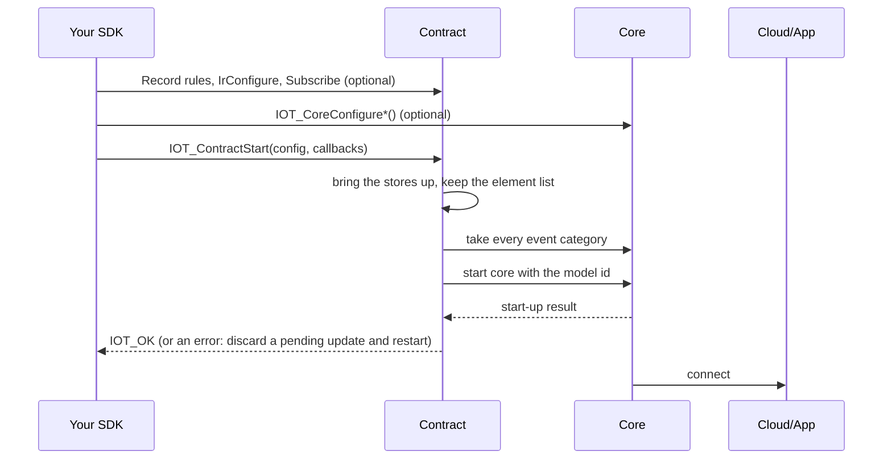
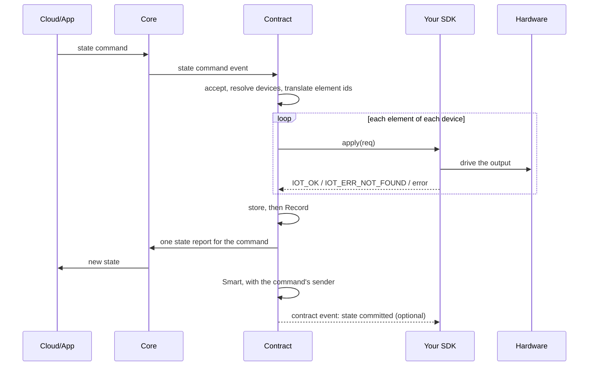
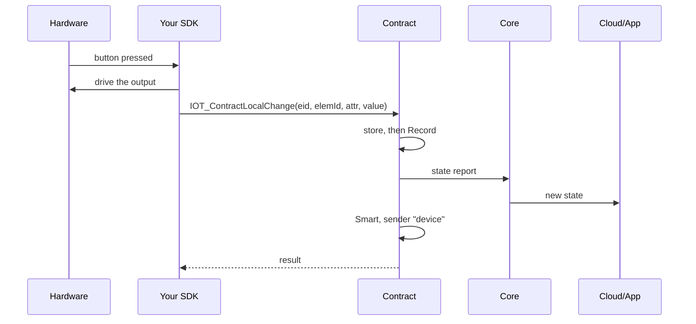
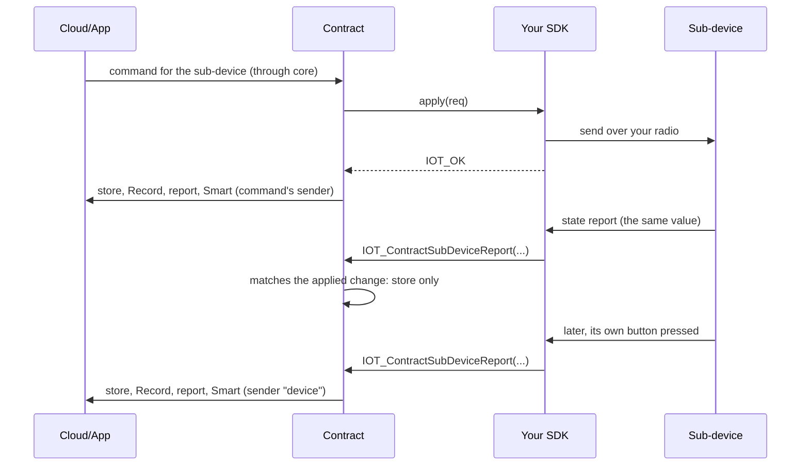
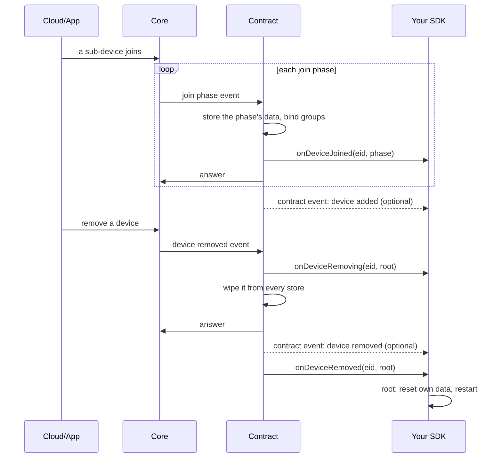
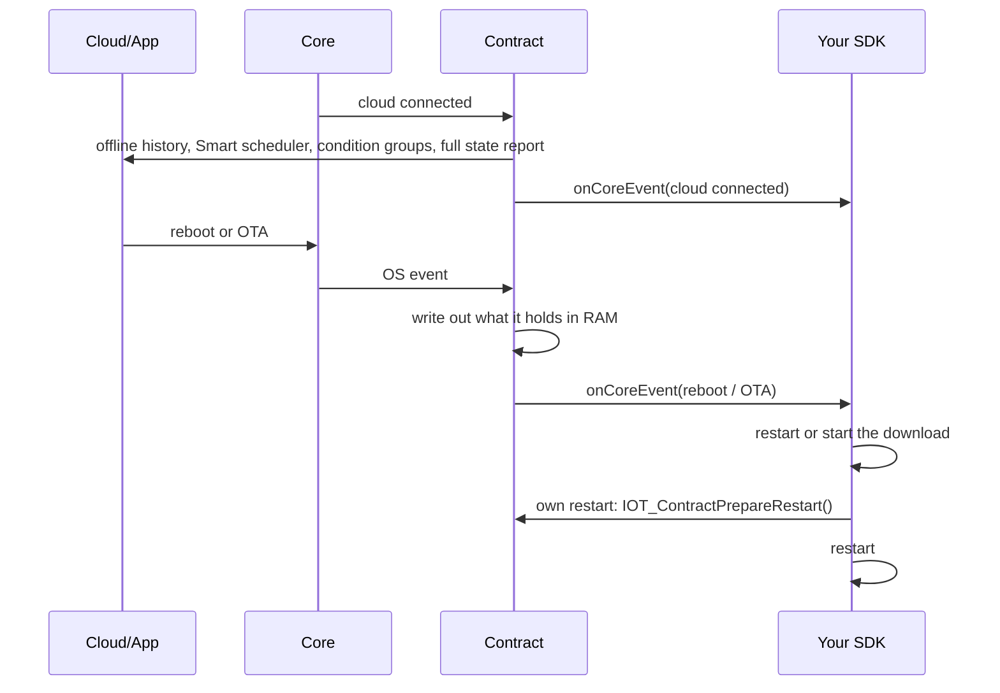

# sdkcontract

The behaviour the cloud and the app rely on a device to have, as one component: it runs every
request that changes cloud-visible state (state commands, device joins and removals, groups, IR
keysets, automations, history), keeps the Device, Group, IR, Smart and Record stores, and sends
every state and history report. Your code drives the hardware and tells the contract when the
hardware changed by itself. It builds on the public core API (`iotcore`), the platform interfaces
(`iotplatform`) and the common utilities (`iotcommon`); nothing in it depends on application code.

## Version

`1.0.0` (`IOT_CONTRACT_VERSION_STRING` in `IOT_Contract.h`). Needs iotcore v2026.10.30 or later.
iotcore has no version query, so this is not checked at run time: build it against a matching
release.

## Two ways to build an SDK

`sdkcontract` is optional. `iotcore` never depends on it.

- **Path A — build on `sdkcontract` (recommended).** You write `apply` and your hardware input;
  the contract keeps Smart, Record and the stores correct, and we fix it when the cloud or the app
  changes what they expect. The rest of this README is for path A.
- **Path B — write your own SDK** against the public `iotcore` API. Your SDK must then perform every
  step this README says the contract does, itself; the Record contract and Smart contract guides
  are your rulebook. Support covers the `iotcore` API and the written rules, not your
  implementation.

## Supported entry points

The headers in `include/` are the partner API, and everything they declare is supported.
`internal_include/` holds the component's own headers: unsupported, may change in any release, and
not on your include path.

| Header | What it gives you |
|---|---|
| `include/IOT_Contract.h` | `IOT_ContractStart()` with your `apply` and hooks; `IOT_ContractLocalChange()`; `IOT_ContractSubDeviceReport()`; `IOT_ContractElementStoreId()`; `IOT_ContractIrConfigure()`; `IOT_ContractSubscribe()` (contract events); `IOT_ContractPrepareRestart()`; `IOT_ContractFactoryReset()` |
| `include/IOT_ContractRecord.h` | Record rules: `IOT_ContractRecordRegisterRule()`, `IOT_ContractRecordClearRules()`, `IOT_ContractRecordSetElementEnabled()`, `IOT_ContractRecordUseCustomStore()`, `IOT_ContractRecordLogValueWidth()` |
| `include/dao/IOT_DaoDeviceMgmt.h` | The Device store, read-only: identity, common info, elements and their state, the mesh key, every device's EID |
| `include/dao/IOT_DaoIRMgmt.h` | The IR store, read-only: protocol codes and rawzip data |

Every function's comment states whether it blocks, whether it is safe from a timer callback, and
which task it must run on. The partner example application shows every call in place.

## What you write vs what the contract does

| You write | The contract does |
|---|---|
| `apply(req)`: drive one element on the hardware, return `IOT_OK` | Accepts the command, translates element ids, calls `apply` per element, then stores, records, reports once per command and feeds Smart with the command's sender |
| `IOT_ContractLocalChange()` when a button or sensor changed an element | Stores, records, reports, feeds Smart with the sender "device" |
| `IOT_ContractSubDeviceReport()` for every state a hub's sub-device reports | Tells an echo of its own change from a real one; commits the real one like a local change |
| `onCoreEvent`: what is still yours (status report, reboot, OTA, IR send/learn, mesh, settings, service messages) | Has already done its part of each forwarded event (table below) |
| `onDeviceJoined`, `onDeviceRemoving`, `onDeviceRemoved` (optional) | Stores the join, binds groups, wipes a removed device from every store, answers the cloud |
| Record rules; optional `IOT_ContractIrConfigure()`, `IOT_ContractRecordUseCustomStore()`, `IOT_ContractSubscribe()` | Answers state queries, both history requests and the IR capability question |

## Start

```c
const IOT_ContractConfig_t config = {
    .modelId = MODEL_ID,                 /* required */
    .elementIds = APP_ELEMENTS,          /* your element numbers, in the cloud model's order */
    .elementCount = APP_ELEMENT_COUNT,   /* at most IOT_CONTRACT_MAX_ELEMENTS */
};
const IOT_ContractCallbacks_t callbacks = {
    .apply = app_apply,                  /* required */
    .onCoreEvent = app_on_core_event,
    .onDeviceRemoved = app_on_device_removed,
};
iot_err_t err = IOT_ContractStart(&config, &callbacks);
```

`IOT_ContractStart()` brings the stores up, keeps a copy of your element list, takes the core
event callback for every category and then starts core. Call it once, from `app_main`, after
`IOT_InitPlatform()`. Both structs are copied.

Before it, and only before it:

- `IOT_ContractRecordRegisterRule()` for each attribute you want history for;
- `IOT_ContractIrConfigure(tx, rx, detect)` if the device does IR (not called: no IR capability);
- `IOT_ContractRecordUseCustomStore(fn)` if you keep history in your own store;
- `IOT_ContractSubscribe(fn, arg)` for contract events;
- core's pre-start settings (`IOT_CoreConfigure*()`).

On path A **never** call `IOT_CoreInit()` or `IOT_DevCoreRegisterEventCb()`, and never call core's
state or history report functions (`IOT_CoreRequestReportState*()`,
`IOT_CoreRequestRecordResponse()`, `IOT_CoreReportRecordBlocks()`): the contract sends every
report, and a second sender reports the same change twice. A core callback registered before Start
makes Start fail with `IOT_ERR_INVALID_STATE` (core is not started); one registered after is refused
by core with the same error.

**Start fails.** Start returns `IOT_ERR_INVALID_ARG` (bad arguments, nothing done), a store or
registration error (core not started), or core's own start-up error. Treat any of them as fatal for
this boot. If a firmware update is pending at that point, discard it and restart: a pending update
makes every boot an update boot, so the device would retry the same failing start forever and could
not be provisioned again. The example does exactly this:

```c
if (err != IOT_OK && IOT_CoreOtaIsPending() && IOT_CoreOtaDiscardPending() == IOT_OK)
{
    IOT_ApplicationRestartChip();
}
```

## Apply

`apply` is called once per element of a state command the contract accepted, in order, device by
device for a command that addresses a group or the whole location. `req->elemId` is your own
element number (declared in `elementIds`) for the device itself, or the hub-assigned id for a
sub-device; never the cloud's id. An element the cloud's model has but you did not declare is
skipped with a warning.

| Return | Meaning |
|---|---|
| `IOT_OK` | The hardware took the value (for a sub-device: it was sent) |
| `IOT_ERR_NOT_FOUND` | This element/attribute is not driven by your product; treated as success, still stored |
| anything else | Stops this device's remaining elements. Elements already applied are committed and reported; the failing one is not. Other devices of the command carry on |

Return `IOT_ERR_NOT_FOUND`, not `IOT_ERR_NOT_SUPPORTED`, for an attribute you do not drive: any
error other than `IOT_ERR_NOT_FOUND` means "not applied" and nothing is stored for it.

A device attribute set reaches `apply` only for the device itself (one call). For a sub-device it
is stored without driving it: no `apply` call.

Do not store, record or report the change yourself. `apply` runs on the task that delivers core
events, or on the timer task for an automation's actions (immediate, delayed or reverse). Keep it
short and non-blocking (the next request waits, and the timer task has a small stack), guard
hardware you also drive from your own tasks, and do not keep `req` or its value after returning.

## Local change and sub-devices

- **`IOT_ContractLocalChange(eid, elemId, attrId, value, len)`** — your hardware changed an element
  by itself. Store, Record, report, then Smart with the sender "device". Smart is skipped only when
  the report could not read the device (`IOT_ERR_DATA_NOT_FOUND`); a failed send does not skip it,
  so local automations keep working offline. Call it from your input task, never from an ISR or a
  timer callback.
- **`IOT_ContractSubDeviceReport(eid, elemId, attrId, value, len, pushNotify)`** — a hub passes
  every state a sub-device reports. A report with the same element, attribute and value as a change
  the contract applied to it in the last 3 seconds is the sub-device confirming that change: only
  the Device store is updated, and the change keeps the sender of the request that caused it. Any
  other report is the sub-device's own change and is committed like a local change. The value must
  have the attribute's declared size (`IOT_AttrGetSize()`), or it is refused.

## Hooks

| Hook | When | Do here |
|---|---|---|
| `onDeviceJoined(eid, phase)` | A sub-device reached a join phase: `DEVICE_INFO` (its common info is stored), `ELM_INFO` (its elements are stored), `SYNC_COMPLETE` (end of the join) | Index the device, refresh your radio's view, ask it for data. The contract answers core after you return |
| `onDeviceRemoving(eid, root)` | Before the contract deletes anything; the device's record is still readable | Release what you hold for it; reset it on its own network |
| `onDeviceRemoved(eid, root)` | The device is gone from every store and the cloud has its answer (also after a failed removal) | `root` true: this device was removed: reset your own data and restart. `root` false: a sub-device; do not restart |

A sub-device that joins again under a new EID loses its old entry through the same two removal
hooks. All hooks run on the task that delivers core events; they may block briefly.

## Contract events

`IOT_ContractSubscribe(fn, arg)` (boot only, up to `IOT_CONTRACT_EVENT_SUBSCRIBERS_MAX`) tells you,
after the fact, what the contract did: a state committed (with its `cause`: state command, local
change, sub-device report or attribute set, and its `source`), an automation ran, a history block
closed or was pushed, a sub-device added, a device removed, a mirrored on/off command refused.
Events are read-only and name elements by your own numbers. They are delivered synchronously on
the task that did the work — the core event task, or the timer task for an automation's actions
(immediate, delayed or reverse) — so keep the callback short and non-blocking. An event raised by a contract call
made from inside your subscriber is not delivered to anyone.

## Forwarded events

Every core event the contract does not handle itself arrives at `onCoreEvent`, on the task that
delivers core events. Do not keep the pointer after you return.

| Event | The contract already | Your SDK gets |
|---|---|---|
| State command, state query, history query (`IOT_EVENT_STATE` `SET`/`GET`/`RECORD`) | Ran it end to end | Nothing (`SET` reaches you as `apply`) |
| Sensor-log request (`IOT_EVENT_TYPE_STATE_SENSOR_LOG`) | Answered it with an empty log, unless a custom store is installed | The request, only with `IOT_ContractRecordUseCustomStore()` |
| `IOT_EVENT_SMART` | Stored and ran it | Nothing |
| Device join, removal, group bind/unbind, attribute set | Stored it and answered the cloud | The hooks above; `apply` for an attribute set on the device itself |
| `DEV_EVENT_CLOUD_CONNECTED` | Sent history recorded offline, started the Smart scheduler, re-synced condition groups, scheduled a full state report of every device | The event: do not re-report state |
| Other `IOT_EVENT_DEVICE` (connection, provisioning, boot, identify, device status request) | Nothing | The event |
| `OS_EVENT_REBOOT`, `OS_EVENT_OTA_REQUESTED` | Wrote out what it holds in RAM (`IOT_ContractPrepareRestart()`) | The event: restart or start the download straight away |
| `OS_EVENT_OTA_BOOT_STARTED` | Nothing | The event: set `data.otaBootStarted.handled` if you run the download, or core discards the update |
| IR keyset store, IR capability question | Stored the keyset; answered with `IOT_ContractIrConfigure()`'s values | Nothing |
| Other `IOT_EVENT_IR` (send, learn) | Nothing | The event |
| `IOT_EVENT_MESH`, `IOT_EVENT_SETTING`, `IOT_EVENT_SERVICE` | Nothing | The event |

With `onCoreEvent` NULL these events are dropped.

## Threading

| Callback / call | Task | Blocking |
|---|---|---|
| `apply` | Core event task, or the timer task (an automation's actions) | Short and non-blocking; guard hardware shared with your own tasks |
| `onCoreEvent`, `onDevice*` | Core event task | May block briefly; the next request waits |
| Contract event subscribers | Core event task, or the timer task (an automation's actions) | Must not block |
| `IOT_ContractStart()`, `IOT_ContractSubscribe()`, `IOT_ContractIrConfigure()`, `IOT_ContractRecordUseCustomStore()` | Boot task, once | Start blocks |
| `IOT_ContractLocalChange()`, `IOT_ContractSubDeviceReport()` | Any task except a timer callback | Blocks (storage, network hand-off) |
| `IOT_ContractPrepareRestart()`, `IOT_ContractFactoryReset()` | Any task | Blocks (storage) |

## Factory reset, restart and OTA

- **Product reset** (long press, console command): call `IOT_CoreFactoryReset()`. Core wipes its
  configuration and reports this device's removal; the contract wipes its stores and calls
  `onDeviceRemoved(eid, true)`, where you reset your own data and restart.
  `IOT_ContractFactoryReset()` wipes only the contract's stores, for an SDK's own recovery (a store
  found unreadable at boot); it is not a product reset.
- **Your own restart** (not requested by the cloud): call `IOT_ContractPrepareRestart()` first, or
  up to `IOT_RECORD_FLUSH_INTERVAL_SEC` of history and the latest element state are lost. A
  cloud-requested reboot or OTA is flushed for you before `onCoreEvent` sees it.

## Reading state

The public stores are read-only; every write is the contract's. The Device store lists a device's
elements under the cloud's ids. To find your own element, look it up by
`IOT_ContractElementStoreId(eid, elemId)`: the contract joins the two by position, as it does for
`apply`. The id comes back unchanged for a sub-device, before provisioning, with no declared
elements, for an undeclared id, and when you declared more elements than the cloud's model has; an
unchanged id is not checked against the store and may be another element's, so trust the result
only for a declared element of a provisioned device.

## Hub notes

- There is no public group read: the contract resolves groups itself.
- To find a sub-device by MAC or device id, loop over `IOT_DaoDeviceGetAllEids()` and read each
  with `IOT_DaoDeviceGetIdentityInfo()`.
- Pass every sub-device state report to `IOT_ContractSubDeviceReport()`, including the ones that
  confirm a change you sent from `apply`.

## How it works

### Boot



### A command from the app or the cloud



### A local change



### A hub sub-device and its echo



### Device join and removal



### Cloud connect, reboot and your own restart



## Record

Register a rule per attribute worth charting with `IOT_ContractRecordRegisterRule()`; the contract
records every committed change a rule matches and answers both history requests.
`IOT_ContractRecordSetElementEnabled()` takes your own element numbers for the device itself and
the hub's ids for a sub-device. `IOT_RECORD_PUSH_ENABLED` (default off) also pushes closed blocks;
check with Rogo that your cloud tenant accepts pushed history before you turn it on. A product with
no history can turn Record off with `IOT_RECORD_ENABLED`: every call still links, nothing is
stored, and a history request gets an empty reply. Details: the Record contract guide.

## Building

Register the component by adding its directory to `EXTRA_COMPONENT_DIRS`. Record and the command
checks read the application's attribute table (`defines/IOT_AttrDefines.h`, copy-and-adapt
reference material, not part of this component): set `IOT_ATTR_DEFINES_DIR` to the directory
containing it before `project.cmake`; the build stops if it is unset. The table must provide
`IOT_AttrGetSize()`, `IOT_AttrRecordValueCount()` and `IOT_AttrResolveSyncOnOffCarrier()`.

## Migrating your SDK

1. Delete your own Device, Group and IR stores, any Smart engine or Record you wrote, and your own
   handling of state commands, joins, group binds and removals: the contract does all of it.
2. Replace your core start and event registration with `IOT_ContractStart()`; move your actuation
   into `apply` and your hardware input onto `IOT_ContractLocalChange()` /
   `IOT_ContractSubDeviceReport()`.
3. Devices that move from your own stores keep no Device, Group or Smart data: the contract does
   not read what your stores wrote. Re-provision every such device after the update (test devices:
   erase the flash first).

## API stability

The names in `include/` are frozen from 1.0.0. A later rename goes through a deprecation release
first: the old name keeps working through that release, and the changelog says what replaces it.

## Patched copies are unsupported

Build this component as shipped. If it does something wrong for your product, report it and we fix
it upstream; a locally patched copy is not supported and is overwritten by the next release.
