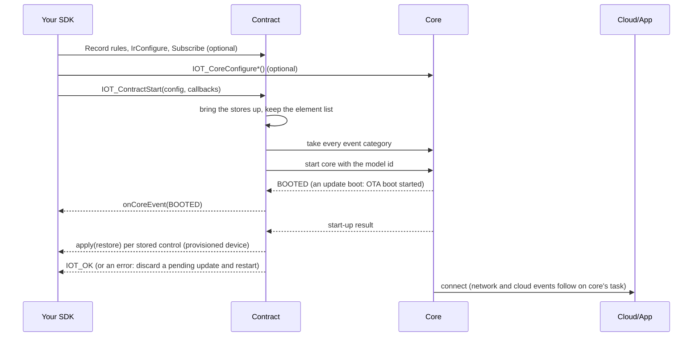
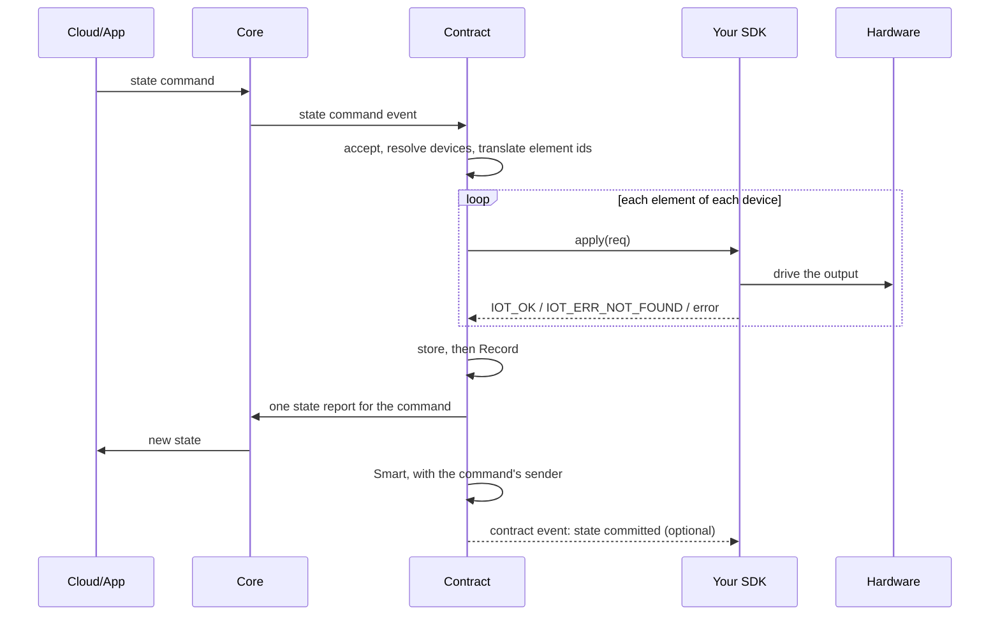
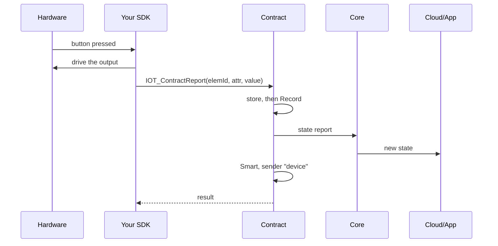
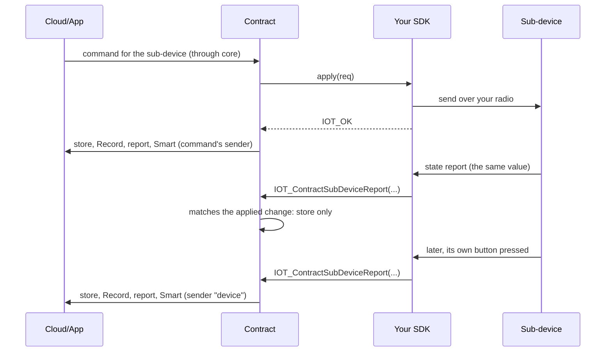
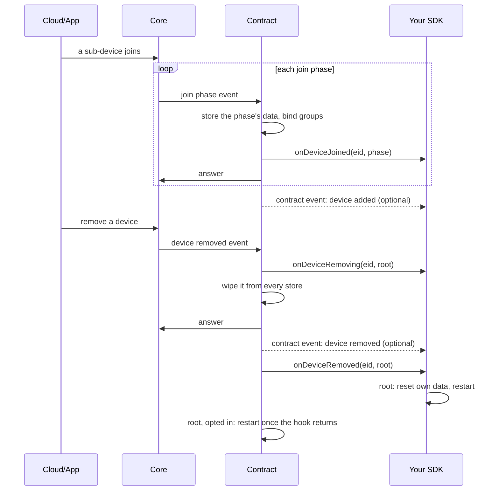
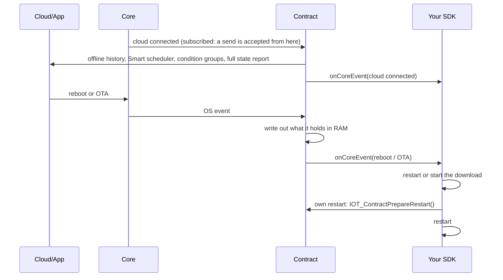

# Concepts

What `sdkcontract` is responsible for, what stays with your SDK, which task each callback runs on,
and how a request flows through the pieces. Read [getting-started.md](getting-started.md) first if
you have not built a device yet; [reference.md](reference.md) lists every name.

## Two ways to build an SDK

`sdkcontract` is optional. `iotcore` never depends on it.

- **Path A — build on `sdkcontract` (recommended).** You write `apply` and your hardware input;
  the contract keeps Smart, Record and the stores correct, and we fix it when the cloud or the app
  changes what they expect. Everything in this folder except the second half of each rulebook is
  for path A.
- **Path B — write your own SDK** against the public `iotcore` API. Your SDK must then perform every
  step these pages say the contract does, itself; the [Record rulebook](record.md) and the
  [Smart rulebook](smart.md) are your rules. Support covers the `iotcore` API and the written
  rules, not your implementation.

## What the contract owns

The contract is the behaviour the cloud and the app rely on a device to have. It runs every request
that changes cloud-visible state and sends every state and history report:

| Request or duty | What the contract does |
|---|---|
| State command (from the cloud, the app, an automation) | Accepts it, resolves the devices it addresses (one device, a group, the whole location), translates element ids, calls your `apply` per element, then stores, records, sends **one** state report per command and feeds Smart with the command's sender |
| State query, both history queries | Answers them from its stores |
| Device join (a hub's sub-device) | Stores each join phase, binds groups, calls `onDeviceJoined`, answers core |
| Device removal, factory reset | Calls `onDeviceRemoving`, wipes the device from every store, answers the cloud, calls `onDeviceRemoved` |
| Group bind / unbind | Stores it; there is no public group read, the contract resolves groups itself |
| Device attribute set | Drives it through `apply` (this device only), stores it, answers |
| Smart (automations, schedules, condition groups) | Stores and runs them; actions come back to your `apply` |
| Record (history) | Records every committed change a rule matches; answers history requests; optionally pushes closed blocks |
| IR keysets and the IR capability question | Stores the keysets; answers with what `IOT_ContractIrConfigure()` declared |
| Cloud connect | Sends history recorded offline, starts the Smart scheduler, re-syncs condition groups, schedules a full state report of every device |
| Reboot or update request | Writes out what it holds in RAM before you see the request |
| Device status request | Answers it with the firmware version, uptime, memory, last state command and hub roles, unless you answered it ([how-to/device-status.md](how-to/device-status.md)) |
| Boot | Restores the last stored state through `apply` (see [how-to/restore-at-boot.md](how-to/restore-at-boot.md)) |

It keeps the **Device, Group, IR, Smart and Record stores**. The Device and IR stores are readable
through the public headers in `include/dao/`; every write is the contract's own.

## What stays yours

| You write | The contract does |
|---|---|
| `apply(req)`: drive one element on the hardware, return `IOT_OK` | Everything before and after it (table above) |
| `IOT_ContractReport()` / `IOT_ContractReportFields()` when your own hardware changed by itself; `IOT_ContractLocalChange()` for an irregular layout | Stores, records, reports, feeds Smart with the sender "device" |
| `IOT_ContractSubDeviceReport()` for every state a hub's sub-device reports | Tells an echo of its own change from a real one; commits the real one like a local change |
| `onCoreEvent`: what is still yours — reboot, update, IR send and learn, mesh keys, settings, identify, messages from your own backend (the device status request too, if you want to answer it yourself) | Has already done its part of each forwarded event ([how-to/core-events.md](how-to/core-events.md)) |
| `onDeviceJoined`, `onDeviceRemoving`, `onDeviceRemoved` (optional) | Stores the join, binds groups, wipes a removed device, answers the cloud |
| Record rules, and the optional pre-start calls | Answers state queries, both history requests and the IR capability question |

On path A **never** call `IOT_CoreInit()` or `IOT_DevCoreRegisterEventCb()`, and never call core's
state or history report functions (`IOT_CoreRequestReportState*()`, `IOT_CoreRequestRecordResponse()`,
`IOT_CoreReportRecordBlocks()`): the contract sends every report, and a second sender reports the
same change twice. A core callback registered before `IOT_ContractStart()` makes the start fail with
`IOT_ERR_INVALID_STATE` (core is not started); one registered after is refused by core with the same
error. Do not store, record or report a change yourself either.

## Before the start, and only before it

`IOT_ContractStart()` is called once, from `app_main`, after `IOT_InitPlatform()`. These optional
calls go before it:

- `IOT_ContractRegisterAttrs(defs, count)` if the product has attribute ids of its own
  ([how-to/custom-attributes.md](how-to/custom-attributes.md));
- `IOT_ContractRecordRegisterRule()` for each attribute you want history for ([record.md](record.md));
- `IOT_ContractIrConfigure(tx, rx, detect)` if the device does IR (not called: no IR capability);
- `IOT_ContractRemovalConfigure(true)` if the contract should restart the device after it is
  removed (not called: you restart from `onDeviceRemoved`);
- `IOT_ContractRestoreConfigure(policy)` if the device must not come back to its last state at boot
  (not called: it does);
- `IOT_ContractRecordUseCustomStore(fn)` if you keep history in your own store;
- `IOT_ContractDeviceStatusConfigure(fn)` to change what the device status request is answered with
  ([how-to/device-status.md](how-to/device-status.md));
- `IOT_ContractSubscribe(fn, arg)` for contract events;
- core's pre-start settings (`IOT_CoreConfigure*()`).

Core's first event comes inside `IOT_ContractStart()`, on your task: `DEV_EVENT_BOOTED` on a normal
boot (before any setup, network or cloud event), or `OS_EVENT_OTA_BOOT_STARTED` on an update boot
(which has no `DEV_EVENT_BOOTED`).

## Element ids: yours, not the cloud's

You declare your own element numbers in `IOT_ContractConfig_t.elementIds`, in the order of the
elements in the model registered with the cloud (at most `IOT_CONTRACT_MAX_ELEMENTS`). The cloud
assigns its own ids at provisioning; the contract joins the two **by position** and translates in
both directions. So `apply`, `IOT_ContractReport()`, `IOT_ContractLocalChange()`,
`IOT_ContractRecordSetElementEnabled()` and every contract event use your numbers for this device.

- An element the cloud's model has but you did not declare is skipped with a warning (never applied).
- A sub-device's element ids are the ones its hub assigned, used as given, never translated.
- With `elementIds` NULL, ids pass through untranslated.
- The Device store lists elements under the cloud's ids: look yours up with
  `IOT_ContractElementStoreId()` ([how-to/read-state.md](how-to/read-state.md)).

## Threading

Core delivers events on its own event task. Everything the contract does for an event runs there,
so your callbacks do too — except an event your own call into core caused, which arrives on **your**
task before that call returns (`DEV_EVENT_BOOTED` and `OS_EVENT_OTA_BOOT_STARTED` inside
`IOT_ContractStart()`, a factory reset's hooks inside `IOT_CoreFactoryReset()`, an event you
dispatch with `IOT_CoreDispatchEvent()`). Two such calls can overlap the event task, so guard state
they share.

| Callback / call | Task | Blocking |
|---|---|---|
| `apply` | Core event task, always — an automation's actions (immediate, delayed or reverse) and the boot restore too | Short and non-blocking: the next request waits. Guard hardware you also drive from your own tasks |
| `onCoreEvent`, `onDevice*` | Core event task; an event your own call caused, on your task inside that call | May block briefly; the next request waits |
| Contract event subscribers | Core event task, which also evaluates triggers and runs every automation a timer starts (an offline schedule, a condition group's timed fire); the first status event, on the task calling `IOT_ContractStart()` | Must not block |
| `IOT_ContractStart()` and the pre-start calls: `IOT_ContractRegisterAttrs()`, `IOT_ContractSubscribe()`, `IOT_ContractIrConfigure()`, `IOT_ContractRemovalConfigure()`, `IOT_ContractRestoreConfigure()`, `IOT_ContractRecordUseCustomStore()` | The boot task (`app_main`), once, before the start | Start blocks |
| `IOT_ContractReport()`, `IOT_ContractReportFields()`, `IOT_ContractLocalChange()`, `IOT_ContractSubDeviceReport()` | Any task except a timer callback (never an ISR) | Blocks (storage, network hand-off) |
| `IOT_ContractPrepareRestart()`, `IOT_ContractFactoryReset()` | Any task | Blocks (storage) |
| `IOT_ContractGetStatus()`, `IOT_ContractAttrSize()`, `IOT_ContractAttrIsKnown()` | Any task, timer callbacks included | No |

Every function's comment in the headers states whether it blocks, whether it is safe from a timer
callback, and which task it must run on.

## Contract events

`IOT_ContractSubscribe(fn, arg)` (boot only, up to `IOT_CONTRACT_EVENT_SUBSCRIBERS_MAX`
subscribers) tells you, after the fact, what the contract did: a state committed (with its `cause`
— state command, local change, sub-device report or attribute set — and its `source`), an
automation ran, a history block closed or was pushed, a sub-device was added, a device was
removed, a mirrored on/off command was refused, and the device status changed. The full list is in
[reference.md](reference.md#contract-events).

Events are read-only, raised after the action finished, and name elements by your own numbers (an
element you did not declare is left out; an event that would name only such elements is not
raised). They are delivered synchronously, in subscription order, on the task that did the work
(see the threading table). Keep the callback short. An event raised by a contract call made from
inside your subscriber is not delivered to anyone; the call itself is carried out in full. New
event types are only ever added at the end; ignore types you do not know.

## How it works

### Boot

### A command from the app or the cloud

### A local change

### A hub sub-device and its echo

### Device join and removal

### Cloud connect, reboot and your own restart

## Building, versions and support

- **Building.** Add the component's directory to `EXTRA_COMPONENT_DIRS`, as
  [examples/minimal](../examples/minimal/CMakeLists.txt) does. The attribute table ships here
  (`IOT_ContractAttrs.h`) and is not edited: register your own ids with
  `IOT_ContractRegisterAttrs()` ([how-to/custom-attributes.md](how-to/custom-attributes.md)). Do
  not link a copy of an attribute table of your own beside it; the duplicate symbols fail the link.
  Build options (Record limits, Record on/off, history push) are in the component's
  [Kconfig](../Kconfig) and described in the [Record rulebook](record.md).
- **Version.** `2.0.0` (`IOT_CONTRACT_VERSION_STRING` in `IOT_Contract.h`). Needs iotcore v2026.11.04
  or later. iotcore has no version query, so this is not checked at run time: build it against a
  matching release.
- **Supported entry points.** The headers in `include/` are the partner API, and everything they
  declare is supported. `internal_include/` holds the component's own headers: unsupported, may
  change in any release, and not on your include path.
- **API stability.** The names in `include/` are frozen from 1.0.0. A later rename goes through a
  deprecation release first: the old name keeps working through that release, and the changelog
  says what replaces it.
- **Patched copies are unsupported.** Build this component as shipped. If it does something wrong
  for your product, report it and we fix it upstream; a locally patched copy is not supported and
  is overwritten by the next release.
