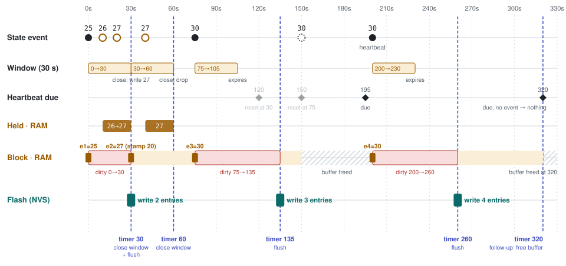
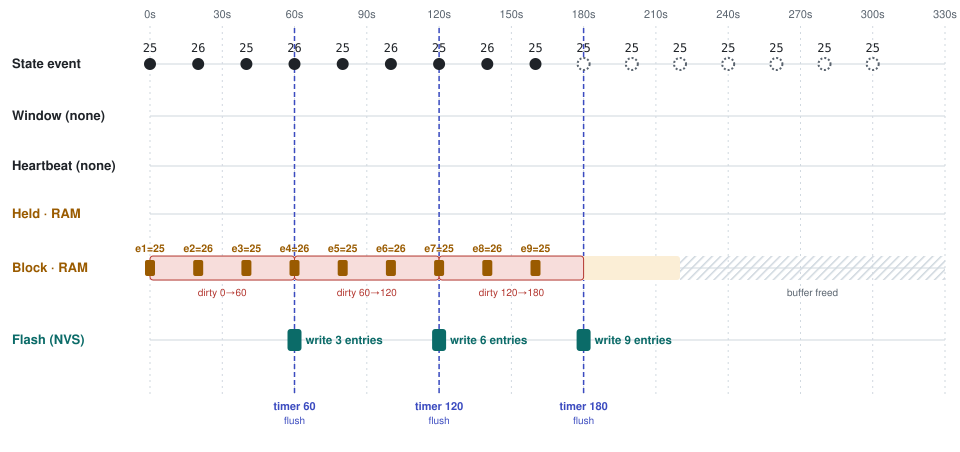

# Record rulebook

How a device keeps the time-stamped history the app charts, and the rules that keep it readable.
The calls are listed in [reference.md](reference.md#iot_contractrecordh); the build options are in
the component's [Kconfig](../Kconfig).

This guide is the Record rulebook for both ways of building an SDK:

- **Path A — you build on `sdkcontract/`.** Its Record keeps every rule below for you, except the
  ones marked **yours on both paths**. Each rule says which call to make.
- **Path B — you write your own Record** against the public `iotcore` API. Every rule below is then
  yours to keep. The second half, [The core Record API](#the-core-record-api), describes the
  `libiotcore.a` calls it is built on.

## What history is

History is kept per **series**: one (device EID, element id, attribute id) triple, with the
cloud's element ids. A series is a chain of **blocks**, newest first; each block holds entries
stamped as offsets from the block's opening time (its checkpoint). The app reads history in two
steps: the GET_STATE reply tells it each series' current checkpoint, and STATE_RECORD requests
(`IOT_EVENT_TYPE_STATE_RECORD`) walk the chain back from there. Optionally the device also pushes
closed blocks to the cloud, so the cloud holds history without the app asking.

Nothing is recorded unless the device decides to record it. A device that records nothing reports
no error: the app simply shows an empty chart.

## Rules

1. **Decide per series what is recorded. Yours on both paths.** Only attributes worth charting
   should be recorded; a series nobody charts costs storage and RAM.
   With sdkcontract: register a rule per attribute with `IOT_ContractRecordRegisterRule()`. A rule
   names a device type (0 for any), an element type and an attribute id. Matching order: an exact
   element override (`IOT_ContractRecordSetElementEnabled()`), then device type + element type +
   attribute, then element type + attribute. No match, no history.
   The element type is what kind of element it is, not which one: it takes an `IOT_DEVTYPE_*`
   value, not an element id. One rule covers every element of that type -- `{IOT_DEVTYPE_SWITCH,
   IOT_ATTR_ONOFF}` records each gang of a 3-gang switch as its own series. To record or skip one
   particular element, use the override.
2. **Record every change, with the cloud's element ids. Yours on both paths.** Every element-state
   change -- from a STATE_SET, from your own hardware, from a sub-device -- must reach Record, keyed
   by the element ids the cloud assigned at provisioning, never your application's own numbering.
   With sdkcontract: done for you on every commit (a state command through `apply`,
   `IOT_ContractReport()`, `IOT_ContractReportFields()`, `IOT_ContractSubDeviceReport()`, a device attribute set). Record
   looks the device and element types up from the Device store itself.
3. **Take the entry width from the attribute id.** Each entry holds 1 value, or 2 for a paired
   reading such as temperature and humidity, and the app reads history with the same count.
   The rule is in the Attribute Reference shipped with the core documentation (History
   entries). Changing the count for an attribute already in the field makes stored history
   unreadable. State width is not history width:
   `IOT_ATTR_OPEN_CLOSE_CTL` holds a command and a position in state but records only the command,
   so never derive the count from the attribute's state size.
   With sdkcontract: done for you, from the contract's attribute table; an attribute you
   register with `IOT_ContractRegisterAttrs()` keeps up to 2 fields.
4. **Rate-limit measurements, never events.** A noisy measurement (a thermometer with jitter) may
   be held for a window and the settled value written; an event (door, smoke, motion) must record
   every transition, or the history is false. Re-recording an unchanged value (a heartbeat) needs a
   floor, or copies fill the ring.
   With sdkcontract: `minIntervalSec` holds changes inside a window (use
   `IOT_CONTRACT_RECORD_EVERY_CHANGE` for events); `heartbeatSec` is clamped up to
   `IOT_RECORD_MIN_HEARTBEAT_SEC`.
   - **`0` is not "no limit".** `0` is `IOT_CONTRACT_RECORD_USE_DEFAULT`: the attribute's own
     default. A field left out of an initialiser is `0` too. To record every change, write
     `IOT_CONTRACT_RECORD_EVERY_CHANGE`. To never repeat an unchanged value, write
     `IOT_CONTRACT_RECORD_NO_HEARTBEAT`.
   - **Make the heartbeat longer than the window.** Closing a window does not check the
     heartbeat, so a heartbeat no longer than `minIntervalSec` repeats at the first report after
     the window rather than on time. `IOT_ContractRecordRegisterRule()` accepts the rule and logs
     a warning once. The comparison uses the values that will run, after defaults and the floor.
5. **Answer both history requests.** The GET_STATE reply carries each series' current checkpoint;
   STATE_RECORD walks the chain. An unknown checkpoint answers with one empty block carrying the
   requested checkpoint, never zero blocks. A series whose checkpoint was taken before the clock was
   set is left out of the GET_STATE reply, because the app would anchor to it. The details are in
   [Answering a query](#answering-a-query) and [GET_STATE](#get_state).
   With sdkcontract: `IOT_ContractStart()` answers both requests itself; there is nothing to call.
6. **Write history before a planned restart.** Entries held in RAM are lost on a restart. A planned
   restart (reboot command, OTA) must write them first; a genuine power cut loses what is in RAM.
   With sdkcontract: a reboot or OTA request from the cloud is flushed before your `onCoreEvent`
   sees it; before a restart of your own, call `IOT_ContractPrepareRestart()`. That call also writes the value a
   window is holding, and it is the call to make when your hardware warns that the power is about to
   fail ([reset-and-restart.md](how-to/reset-and-restart.md#when-the-power-is-about-to-fail)). A power cut with no warning loses up to
   `IOT_RECORD_FLUSH_INTERVAL_SEC` (60 by default) of entries, plus a change a rule's
   `minIntervalSec` window is still holding, so the worst case is the flush interval plus your
   longest `minIntervalSec`.
7. **Keep the stored layout stable.** The next firmware reads the blocks, and the per-series "last
   pushed" bookmark, that this one wrote. Changing the layout of stored history is an upgrade-path
   change.
   With sdkcontract: you do not edit `sdkcontract/` and you do not write Record's storage yourself.
8. **Forget a device's history when the device goes.** A removed device's series and bookmarks are
   deleted, and a factory reset deletes all of them.
   With sdkcontract: done for you when the cloud removes a device, and on a factory reset
   (`IOT_CoreFactoryReset()`).
9. **Overrides use the cloud's element ids too.** An override keyed by your own numbering matches
   nothing, and nothing reports an error.
   With sdkcontract: `IOT_ContractRecordSetElementEnabled()` takes your own element number for
   the device itself (declared in `IOT_ContractConfig_t.elementIds`; the contract translates it)
   and the hub-assigned id for a sub-device. With no elements declared, ids are used as given.
10. **Push only once your cloud accepts it.** Check with Rogo that your tenant's cloud accepts
    pushed history before you push. Push closed blocks only, oldest first, paced after a
    reconnect, and resume on every cloud connect. Delivery is at-least-once: resending a block
    with the same checkpoint is harmless, so a resend after a reboot needs no special handling. The rules for the push call are in
    [Pushing closed blocks](#pushing-closed-blocks).
    With sdkcontract: set `IOT_RECORD_PUSH_ENABLED`; the contract resumes on every cloud connect
    itself.

## sdkcontract: when history reaches RAM and when it reaches flash

Record keeps each series' open block in RAM and writes the whole block to flash from time to time.
Three rules decide everything:

- **A state event becomes an entry in RAM, or nothing.** Inside a window it is only *held*; a later
  value replaces it. Outside a window it becomes an entry at once if it changed, or if the heartbeat
  is due. Otherwise nothing is recorded and nothing is written. A device that reports an unchanged
  value all day never writes flash for it.
- **Only new entries make flash writes.** A block with an entry not yet written is *dirty*. It is
  written no later than `IOT_RECORD_FLUSH_INTERVAL_SEC` after its first unwritten entry, and events
  arriving meanwhile do not postpone that. A full block is written at once. So a series writes flash
  at most about once per flush interval, and only while its values keep producing entries.
- **One timer does all the waiting.** It wakes for whichever comes first: a window holding a value
  that has to close, or a dirty block that has to be written. Every wake does every job that is due
  and writes every dirty block. The heartbeat has no timer; it is checked only when an event arrives.

The timeline below is one attribute with `minIntervalSec` 30 and `heartbeatSec` 120, at the default
flush interval of 60 s. State events arrive at 0, 10, 20, 40, 75, 150 and 200 s. Both the picture and
the table are generated by running Record itself on a simulated clock, so every mark is a time the
code produced.



How to read it:

- A filled dot is an event that became an entry. A hollow one was held inside a window. A dashed one
  was neither, because it was unchanged with no heartbeat due.
- An entry closed out of a window carries the time its value *arrived*: e2 is written at 30 but
  stamped 20.
- A red span is a dirty block: those entries exist only in RAM and are what a power cut would lose.
- After each flush the timer wakes once more, 60 s later, only to free the block's RAM buffer if the
  series has stayed quiet. That follow-up also writes anything that became dirty meanwhile.

<!-- record-timeline:begin (generated by the SDK's own tests; do not edit) -->

| s | What happens | Held (RAM) | Block (RAM) | Flash | Timer next |
|---|---|---|---|---|---|
| 0 | Event 25, first value: entry e1 now. Window opens: 30 s, closes at 30. Heartbeat due at 120. Block dirty: flush due at 60. | — | 1 entry, dirty | — | 60 |
| 10 | Event 26, inside the window: held (arrived at 10), not recorded yet. The window close at 30 is earlier than the armed wake, so the timer moves to it. | 26 (arrived 10) | 1 entry, dirty | — | 30 |
| 20 | Event 27, inside the window: held (arrived at 20), not recorded yet. | 27 (arrived 20) | 1 entry, dirty | — | 30 |
| 30 | **Timer.** Closes the window: 27 differs, entry e2 stamped 20 (when it arrived). Window opens: 30 s, closes at 60. Heartbeat due at 150. Writes the dirty block to flash. Re-arms 60 s later to free the buffer if still idle. | — | 2 entries | write (2 entries) | 90 |
| 40 | Event 27, inside the window: held (arrived at 40), not recorded yet. The window close at 60 is earlier than the armed wake, so the timer moves to it. | 27 (arrived 40) | 2 entries | — | 60 |
| 60 | **Timer.** Closes the window: the held 27 equals the last entry, so it is dropped; no new window. | — | 2 entries | — | none |
| 75 | Event 30, outside the window and changed: entry e3 now. Window opens: 30 s, closes at 105. Heartbeat due at 195. Block dirty: flush due at 135. | — | 3 entries, dirty | — | 135 |
| 135 | **Timer.** Writes the dirty block to flash. Re-arms 60 s later to free the buffer if still idle. | — | 3 entries | write (3 entries) | 195 |
| 150 | Event 30, unchanged, outside the window, heartbeat not due (195): nothing recorded. The block is written and has had no new entry for at least 60 s, so its buffer is freed. Nothing is left to wait for, so the armed wake at 195 is cancelled. | — | buffer freed | — | none |
| 200 | Event 30, unchanged but past the heartbeat due at 195: entry e4, stamped 200. Its block is read back from flash first. Window opens: 30 s, closes at 230. Heartbeat due at 320. Block dirty: flush due at 260. | — | 4 entries, dirty | — | 260 |
| 260 | **Timer.** Writes the dirty block to flash. Re-arms 60 s later to free the buffer if still idle. | — | 4 entries | write (4 entries) | 320 |
| 320 | **Timer.** Follow-up wake: nothing to close or write. No new entry for at least 60 s: buffer freed. | — | buffer freed | — | none |

<!-- record-timeline:end -->

### Steady traffic: is flash written all the time?

No. The second timeline is one attribute that records every change, with no heartbeat. Its value
changes every 20 s until 160 s, then the device keeps reporting the same value every 20 s.



- While the value keeps changing, entries collect in RAM and the block is written once every 60 s:
  three writes, carrying 3, 6 and 9 entries. Events arriving in between never push a write back.
- Once the value stops changing, the reports record nothing, so nothing is written. The block's RAM
  buffer is freed after 60 s without a new entry.
- What a power cut can lose is the red span: at most `IOT_RECORD_FLUSH_INTERVAL_SEC` of entries.

<!-- record-timeline-steady:begin (generated by the SDK's own tests; do not edit) -->

| s | What happens | Held (RAM) | Block (RAM) | Flash | Timer next |
|---|---|---|---|---|---|
| 0 | Event 25, first value: entry e1 now. No window: every change is recorded. Block dirty: flush due at 60. | — | 1 entry, dirty | — | 60 |
| 20 | Event 26, changed: entry e2 now. No window: every change is recorded. | — | 2 entries, dirty | — | 60 |
| 40 | Event 25, changed: entry e3 now. No window: every change is recorded. | — | 3 entries, dirty | — | 60 |
| 60 | **Timer.** Writes the dirty block to flash. Re-arms 60 s later to free the buffer if still idle. | — | 3 entries | write (3 entries) | 120 |
| 60 | Event 26, changed: entry e4 now. No window: every change is recorded. Block dirty: flush due at 120. | — | 4 entries, dirty | — | 120 |
| 80 | Event 25, changed: entry e5 now. No window: every change is recorded. | — | 5 entries, dirty | — | 120 |
| 100 | Event 26, changed: entry e6 now. No window: every change is recorded. | — | 6 entries, dirty | — | 120 |
| 120 | **Timer.** Writes the dirty block to flash. Re-arms 60 s later to free the buffer if still idle. | — | 6 entries | write (6 entries) | 180 |
| 120 | Event 25, changed: entry e7 now. No window: every change is recorded. Block dirty: flush due at 180. | — | 7 entries, dirty | — | 180 |
| 140 | Event 26, changed: entry e8 now. No window: every change is recorded. | — | 8 entries, dirty | — | 180 |
| 160 | Event 25, changed: entry e9 now. No window: every change is recorded. | — | 9 entries, dirty | — | 180 |
| 180 | **Timer.** Writes the dirty block to flash. Re-arms 60 s later to free the buffer if still idle. | — | 9 entries | write (9 entries) | 240 |
| 180 | Event 25, unchanged, no heartbeat: nothing recorded. Nothing is left to wait for, so the armed wake at 240 is cancelled. | — | 9 entries | — | none |
| 200 | Event 25, unchanged, no heartbeat: nothing recorded. | — | 9 entries | — | none |
| 220 | Event 25, unchanged, no heartbeat: nothing recorded. The block is written and has had no new entry for at least 60 s, so its buffer is freed. | — | buffer freed | — | none |
| 240 | Event 25, unchanged, no heartbeat: nothing recorded. | — | buffer freed | — | none |
| 260 | Event 25, unchanged, no heartbeat: nothing recorded. | — | buffer freed | — | none |
| 280 | Event 25, unchanged, no heartbeat: nothing recorded. | — | buffer freed | — | none |
| 300 | Event 25, unchanged, no heartbeat: nothing recorded. | — | buffer freed | — | none |

<!-- record-timeline-steady:end -->

## sdkcontract: limits you can tune

Declared in the component's [Kconfig](../Kconfig). None of the limits changes the message or storage format; they
bound RAM, flash and write frequency.

| Option | Default | Range | Meaning |
|---|---|---|---|
| `IOT_RECORD_MAX_OPEN_BLOCKS` | 6 | 1..64 | Blocks held in RAM at once |
| `IOT_RECORD_MAX_INSTANCES` | 32 | 1..255 | Series tracked; series past the limit are not recorded |
| `IOT_RECORD_BLOCKS_PER_ATTR` | 16 | 1..64 | Ring depth per series |
| `IOT_RECORD_FLUSH_INTERVAL_SEC` | 60 | 1..3600 | Longest a dirty block stays in RAM |
| `IOT_RECORD_MIN_HEARTBEAT_SEC` | 120 | 1..3600 | Smallest heartbeat honoured |
| `IOT_RECORD_ENABLED` | y | bool | Build Record at all; see below |
| `IOT_RECORD_PUSH_ENABLED` | n | bool | Push closed blocks to the cloud (rule 10) |

**Do not lower `IOT_RECORD_BLOCKS_PER_ATTR` on devices already deployed.** Blocks beyond the new
depth are ignored at boot, which ones is decided by storage scan order and not by age, and later
rotations may overwrite them. History is lost. Raising it is safe. Set it once per product.

**Turning Record off.** A product with no history (a relay, an IR blaster) can set
`IOT_RECORD_ENABLED` off to save Record's RAM. Every Record call still links; rules are accepted and
ignored, nothing is stored, a GET_STATE reply carries no history, and a history request gets an
empty reply. History a previous firmware stored is neither served nor removed while it is off.

## sdkcontract: a custom history store

Call `IOT_ContractRecordUseCustomStore(fn)` before `IOT_ContractStart()` to take over where an
accepted entry goes, for a product that must keep its own log format. Record still matches every
change against your rules and hands each accepted one to `fn`; it keeps no blocks of its own and
pushes nothing, and the day-keyed history request (`IOT_EVENT_TYPE_STATE_SENSOR_LOG`) reaches your
`onCoreEvent` so your store can answer it. Without a custom store the contract answers that request
with an empty log. With Record turned off (`IOT_RECORD_ENABLED`), `fn` is never called, so a
product that logs through one stops logging.

## How history is organised

| Term | Meaning |
|---|---|
| Series | One `{eid, elemId, attrId}`. Each series has its own chain. |
| Block | A run of entries sharing one checkpoint, up to a fixed capacity that is smaller for a two-value attribute. |
| `checkpoint` | Epoch **milliseconds** when the block opened: the block's time origin. Never 0 for a real block. |
| `prevCheckpoint` | Checkpoint of the next older block. `0` means nothing older; the app stops. |
| Entry | One value (or two, by `valueCount`) and its offset in seconds from the block's checkpoint, at most 65535 (about 18 hours). |
| `valueCount` | 1 or 2 values per entry, always from the attribute id (rule 3). |
| Open block | The block currently being appended to. |
| Closed block | A block that has rotated out. Only closed blocks are pushed. |

**Order.** Entries inside a block run oldest to newest. Blocks in a query reply run newest first.
Blocks in a push run oldest first.

**A block closes** when it is full, when the next entry's offset would exceed 65535 seconds, or
when the clock stepped backward.

**How the app reads history.** GET_STATE gives it each series' current checkpoint; it asks for
that checkpoint; the device returns that block and older ones, newest first; it asks again from
the last `prevCheckpoint` it got, and stops at `0`. A reply carries a bounded number of blocks,
so a long chain takes several requests.

**Order by sequence, not time.** Record stores a sequence number with each block and orders the
ring by it on boot, because a backward clock step makes checkpoints go backwards. The push
bookmark is a sequence number for the same reason.

**Nothing before time sync.** Record does not hand the app a checkpoint taken before the clock was
set: a block stamped in 1970 would stay in the chain forever.

## The core Record API

This is the API a path-B Record is built on, and what sdkcontract's Record already does for you on
path A (on path A, never call these yourself: the contract sends every history reply and push). The
shipped headers `IOT_CoreRecord.h`, `IOT_CoreEventState.h` and `IOT_CoreState.h` are the
authority.

**Your code decides what to record and stores it; core turns it into messages.** Core records
nothing on its own, parses the app's history query, owns the message format and the reply size
limit, and delivers to the cloud. Record V1 (`IOT_CoreSensorLog.h`, day-keyed) is not in the
shipped library: `IOT_CoreRequestSensorLogResponse()` sends nothing and returns
`IOT_ERR_NOT_SUPPORTED`.

The contract is one event in and three calls out. You hand core values in host order; you never
pack, byte-swap or pad.

| Direction | Name | Header | When |
|---|---|---|---|
| core → you | `IOT_EVENT_TYPE_STATE_RECORD` with `IOT_EventStateRecordRequest_t` | `IOT_CoreEventState.h` | The app asks for one block of history |
| you → core | `IOT_CoreRequestRecordResponse()` | `IOT_CoreRecord.h` | Your answer to that event |
| you → core | `recordBlocks` / `numRecordBlocks` on `IOT_CoreStateResponse_t` | `IOT_CoreState.h` | Inside a GET_STATE reply, to give the app its first checkpoint |
| you → core | `IOT_CoreReportRecordBlocks()` | `IOT_CoreRecord.h` | Push of closed blocks |

### The block

```c
typedef struct {
    uint64_t checkpoint;       // epoch ms the block opened
    uint64_t prevCheckpoint;   // next older block, 0 = none
    const uint16_t *fields;    // see IOT_CoreRecord.h: values and offsets, oldest entry first
    uint16_t fieldCount;       // total uint16s, NOT entries
} IOT_CoreRecordBlock_t;
```

- `fieldCount` must divide by `valueCount + 1`. Core checks it and rejects the block if not.
- Give paired values in their natural order; core handles any reordering.
- `fields` is borrowed for the call only, so one scratch buffer can be refilled per block.

### Answering a query

The event carries `eid`, `elemId`, `attrId`, `checkpoint` and `ctx`. `checkpoint = 0` means the
current (open) block.

- Return the requested block first, then its older blocks, newest first. The walk is inclusive.
- `blockCount` is never 0. For an unknown or evicted checkpoint, send one block with
  `checkpoint` = the value asked for, `prevCheckpoint = 0` and `fieldCount = 0`.
- Offer as many blocks as you like. Core stops at its reply size limit without failing; the app
  asks again from the last `prevCheckpoint` it got.
- Call it synchronously inside the event callback: `ctx.senderId` points into a buffer that is
  freed when your handler returns.

### GET_STATE

When the GET_STATE request carries a time request (`unixTime` non-NULL), attach the open block of
each recorded attribute of that `eid` as `IOT_CoreRecordStateBlock_t` (block +
`eid`/`elemId`/`attrId`/`valueCount`), at most `IOT_CORE_RECORD_STATE_BLOCKS_MAX`. `NULL`/0 is
fine: the device records nothing yet, or its clock has not synced.

### Pushing closed blocks

`IOT_CoreReportRecordBlocks()` sends 1 to `IOT_CORE_RECORD_PUSH_BLOCKS_MAX` closed blocks of one
series, oldest first, to the cloud. It is all or nothing; core never trims a push. It takes no
request context. It blocks until the message is handed to the cloud connection, so call it from
a task, never from a timer callback.

| Code | From | Means | Do |
|---|---|---|---|
| `IOT_OK` | both | Handed to the cloud connection | Push: move your bookmark |
| `IOT_ERR_INVALID_ARG` | both | NULL, `blockCount` 0 (or above the push limit), `valueCount` not 1–2 | Fix the caller |
| encoder error | push | A malformed block, e.g. a `fieldCount` that does not divide | Fix the caller |
| `IOT_ERR_INVALID_STATE` | push | Cloud session not fully up yet (it comes up after the connect event) | Retry soon |
| any other non-OK | push | Not sent | Keep the bookmark, retry later |

### Rules and pitfalls

| Rule | What goes wrong otherwise |
|---|---|
| Never pre-pack, byte-swap or pad entries | Core packs them again; the app reads garbage |
| Take `valueCount` from the attribute id (rule 3), never from the state size | Curtains (`OPEN_CLOSE_CTL`) read the offset as a position |
| Never return `blockCount = 0`; echo an unknown checkpoint in an empty block | The app restarts its walk from the head of the chain |
| No real block may have `checkpoint = 0` | `0` already means both "current block" and "end of chain" |
| Reply synchronously, inside the event callback | The reply is routed through freed memory |
| Never push from a timer callback or while holding your own record lock | The call blocks; a timer task overflows its stack |
| One series per push, oldest first, at most `IOT_CORE_RECORD_PUSH_BLOCKS_MAX` blocks | Rejected with `IOT_ERR_INVALID_ARG` |
| Push only closed blocks that are already on flash | The cloud gets a block you may still change or lose |
| Move your "last pushed" bookmark only on `IOT_OK`; keep it by sequence number, not checkpoint | Blocks are skipped; a clock step reorders checkpoints |
| Pace the reconnect backlog, a gap between calls | A burst fills the outgoing queue and exhausts the heap the secure connection needs |
| Record nothing before time sync | 1970-stamped blocks stay in the chain |

Core reads no Record build option: the shipped `libiotcore.a` always has this API. Ring depth,
flush interval, recording policy and whether to push are settings of the Record that calls it
(for sdkcontract, its Kconfig above).

### Minimal sketch

For a partner writing their own Record. Functions starting `my_` are your own storage; everything
else is the shipped API.

```c
#include "IOT_CoreEventHandler.h"
#include "IOT_CoreRecord.h"
#include "IOT_ContractAttrs.h"          /* IOT_ATTR_*, IOT_ContractAttrSize() */

#define MY_MAX_BLOCKS 8

/* 1 or 2 values per entry: the leading fields, at most two; OPEN_CLOSE_CTL keeps 1. */
static uint8_t my_value_count(uint16_t attrId)
{
    uint16_t fields = IOT_ContractAttrSize(attrId) / 2;
    if (attrId == IOT_ATTR_OPEN_CLOSE_CTL || fields < 2)
        return 1;
    return 2;
}

/* 1. Answer the app's history query -- synchronously, inside the callback. */
static void on_state_event(void *arg, const IOT_CoreEvent_t *event)
{
    const IOT_CoreStateEvent_t *st = &event->evt.state;
    if (st->type != IOT_EVENT_TYPE_STATE_RECORD)
        return;

    const IOT_EventStateRecordRequest_t *req = &st->data.recordRequest;
    IOT_CoreRecordBlock_t blocks[MY_MAX_BLOCKS];

    /* Fill newest first, starting AT req->checkpoint (0 = the open block). */
    uint16_t n = my_record_walk(req->eid, req->elemId, req->attrId,
                                req->checkpoint, blocks, MY_MAX_BLOCKS);
    if (n == 0)
    {
        /* Unknown or evicted: echo it back in one empty block. */
        blocks[0] = (IOT_CoreRecordBlock_t){ .checkpoint = req->checkpoint };
        n = 1;
    }

    IOT_CoreRecordResponse_t rsp = {
        .eid = req->eid, .elemId = req->elemId, .attrId = req->attrId,
        .valueCount = my_value_count(req->attrId),
        .blocks = blocks, .blockCount = n,
        .ctx = req->ctx,
    };
    IOT_CoreRequestRecordResponse(&rsp);   /* core trims to its limit */
}

/* 2. Push closed blocks -- from a task, never a timer callback. */
void my_push_task_step(uint16_t eid, uint16_t elemId, uint16_t attrId)
{
    IOT_CoreRecordBlock_t blocks[IOT_CORE_RECORD_PUSH_BLOCKS_MAX];

    /* Oldest first, only closed blocks already on flash, after the bookmark. */
    uint16_t n = my_record_unsent(eid, elemId, attrId, blocks, IOT_CORE_RECORD_PUSH_BLOCKS_MAX);
    if (n == 0)
        return;

    IOT_CoreRecordPush_t push = {
        .eid = eid, .elemId = elemId, .attrId = attrId,
        .valueCount = my_value_count(attrId),
        .blocks = blocks, .blockCount = n,
    };
    if (IOT_CoreReportRecordBlocks(&push) == IOT_OK)
        my_record_advance_bookmark(eid, elemId, attrId, n);  /* only on IOT_OK */
    /* else: leave the bookmark; retry on reconnect or the next close */
}
```

Register `on_state_event` with `IOT_DevCoreRegisterEventCb(IOT_EVENT_STATE, on_state_event, NULL)`.
For GET_STATE, fill `recordBlocks` / `numRecordBlocks` on your `IOT_CoreStateResponse_t` with each
series' open block when `unixTime` is non-NULL.
